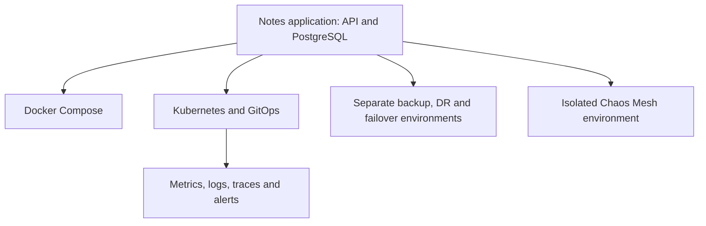

# DevOps in practice

English · [Português](README.md)

This is the starting point for my DevOps labs. A notes application with an API and PostgreSQL connects the work: it starts in containers, then grows into image publication, Kubernetes, GitOps, observability and recovery exercises.

Each repository contains the code, instructions and a record of what happened during testing. Failed builds, restore warnings and investigations with open questions are part of that record.

**[Architecture overview](docs/architecture.en.md) · [Study order](docs/study-guide.en.md) · [Results and evidence](docs/results.en.md)**

## How the work fits together

Labs reuse the application in different environments. The [architecture map](docs/architecture.en.md) explains GHCR publication, Argo CD's role and shared components. Jenkins, Terraform and Ansible have their own exercises, connected through the study route. Firecracker adds an independent Linux/KVM microVM route; the notes application has not been run in that guest.

## A few results to open first

| Question | Where to look |
| --- | --- |
| What happens when a replica disappears? | [Capture inside the resilience matrix](https://github.com/tommmdl/chaos-lab/blob/main/docs/resilience-timeouts.en.md): 146 CI checks and five reproduced TCP timeouts; one backend remains unidentified. |
| Can the application move to another cluster and return? | [Failover and failback](https://github.com/tommmdl/failover-lab/blob/main/docs/validation.en.md): 48 checks locally and in CI, with previous-writer fencing and reconciliation of an uncertain write. |
| Does the backup actually restore? | [Cross-cluster recovery](https://github.com/tommmdl/disaster-recovery-lab/blob/main/docs/validation.en.md): 32 checks locally and in CI, with data comparisons and two retained restore warnings. |
| Is the published image the one that passed its tests? | [GitHub Actions delivery](https://github.com/tommmdl/github-actions-lab/blob/main/docs/validation.en.md): a recorded run with 23 tests and image identity checks through the GHCR pull. |
| Does the microVM actually boot and shut down? | [Kernel and image from scratch](https://github.com/tommmdl/firecracker-lab/blob/main/docs/build-from-source.en.md): two passing local boots after fixing shutdown, ten regressions and the retained initial failure; hardening remains pending. |

Counts belong to the executions linked above. The [results guide](docs/results.en.md) includes further evidence for self-heal, tracing and image migrations with tested rollback.

## The 21 labs

| Stage | Repository | What to practise |
| --- | --- | --- |
| 1 · Foundations | [linux-operations-lab](https://github.com/tommmdl/linux-operations-lab/blob/main/README.en.md) | Read memory, disk and load before forming a diagnosis. |
| 2 · Application | [docker-lab](https://github.com/tommmdl/docker-lab/blob/main/README.en.md) | Connect API and database, retain data and recover from a dependency failure. |
| 3 · Delivery | [jenkins-lab](https://github.com/tommmdl/jenkins-lab/blob/main/README.en.md) | Compare successful and failed builds and both sets of artifacts. |
| 3 · Delivery | [github-actions-lab](https://github.com/tommmdl/github-actions-lab/blob/main/README.en.md) | Test an application revision and publish the same image to GHCR. |
| 4 · Automation | [terraform-lab](https://github.com/tommmdl/terraform-lab/blob/main/README.en.md) | Create Docker resources with modules, observe drift and run destroy. |
| 4 · Automation | [ansible-lab](https://github.com/tommmdl/ansible-lab/blob/main/README.en.md) | Configure two Docker targets, verify idempotence and repair drift. |
| 5 · Cluster | [kubernetes-lab](https://github.com/tommmdl/kubernetes-lab/blob/main/README.en.md) | Explore replicas, Services, PVCs, scaling and rollback in kind. |
| 5 · Cluster | [kubernetes-config-lab](https://github.com/tommmdl/kubernetes-config-lab/blob/main/README.en.md) | Work through 26 ConfigMap, Secret, TLS and Downward API exercises. |
| 6 · Desired state | [argocd-lab](https://github.com/tommmdl/argocd-lab/blob/main/README.en.md) | Compare drift with self-heal disabled and enabled. |
| 6 · Images | [security-lab](https://github.com/tommmdl/security-lab/blob/main/README.en.md) | Read scans, understand blocked gates and test alternatives while retaining findings. |
| 6 · Delivery platform | [gitops-delivery-platform](https://github.com/tommmdl/gitops-delivery-platform) | Promote a signed, digest-pinned image through a GitOps PR, with SBOM, kind integration and a Terraform EKS reference validated without apply. |
| 7 · Observability | [monitoring-lab](https://github.com/tommmdl/monitoring-lab/blob/main/README.en.md) | Query HTTP probes through Prometheus and Grafana. |
| 7 · Observability | [logging-lab](https://github.com/tommmdl/logging-lab/blob/main/README.en.md) | Follow API and database logs through Alloy, Loki and Grafana. |
| 7 · Observability | [tracing-lab](https://github.com/tommmdl/tracing-lab/blob/main/README.en.md) | Follow HTTP/SQL spans and locate logs using the trace ID. |
| 7 · Observability | [alerting-lab](https://github.com/tommmdl/alerting-lab/blob/main/README.en.md) | Introduce faults and verify notifications, grouping and recovery. |
| 7 · Observability | [mimir-lab](https://github.com/tommmdl/mimir-lab/blob/main/README.en.md) | Send metrics from two Prometheus servers to separate Mimir tenants and check persistence and recovery. |
| 8 · Recovery | [backup-restore-lab](https://github.com/tommmdl/backup-restore-lab/blob/main/README.en.md) | Restore resources and a PostgreSQL dump with Velero into another namespace. |
| 8 · Recovery | [disaster-recovery-lab](https://github.com/tommmdl/disaster-recovery-lab/blob/main/README.en.md) | Recover into another cluster with the exercise source stopped and fenced. |
| 8 · Recovery | [failover-lab](https://github.com/tommmdl/failover-lab/blob/main/README.en.md) | Perform a controlled switch with synchronous replication and return the data. |
| 9 · Investigation | [chaos-lab](https://github.com/tommmdl/chaos-lab/blob/main/README.en.md) | Exercise Pod/network faults and correlate HTTP, alerts, packets and kernel events. |
| 10 · MicroVMs | [firecracker-lab](https://github.com/tommmdl/firecracker-lab/blob/main/README.en.md) | Build a kernel/rootfs from pinned sources, test boot and shutdown, and examine pending hardening. |

The [study order](docs/study-guide.en.md) explains what to prepare, observe and understand before moving on. Start with Linux and Docker, or open a result and work back through the components behind it.

## Following and repeating the work

Each lab README covers its prerequisites, setup and cleanup. Several integrations expect sibling repository checkouts; the guide identifies these dependencies. You can explore the portfolio without running every environment at once.

Tests use Docker/WSL, kind and Firecracker microVMs with KVM. Clusters on the same host share a failure domain; recovery exercises do not measure machine loss or production availability. Scans and timings describe the recorded executions.

I used an AI coding assistant (Claude Code) to write much of the scripts, manifests and documentation. The decisions are mine: which scenarios to test and with which tools, what counts as a pass, running and checking every validation, and investigating the failures, such as the false positive in the chaos-lab Pod replacement check and the wrong ID-sequence assumption in the failover-lab. Every claim links to a report that can be rerun. The [journal](journal/README.en.md) tracks progress; the [notes template](templates/daily-log.en.md) helps record hypotheses, mistakes and next steps. The pace is flexible, with no automatic daily publication.

Documentation in Portuguese and English · [About the history update](docs/history.md)
