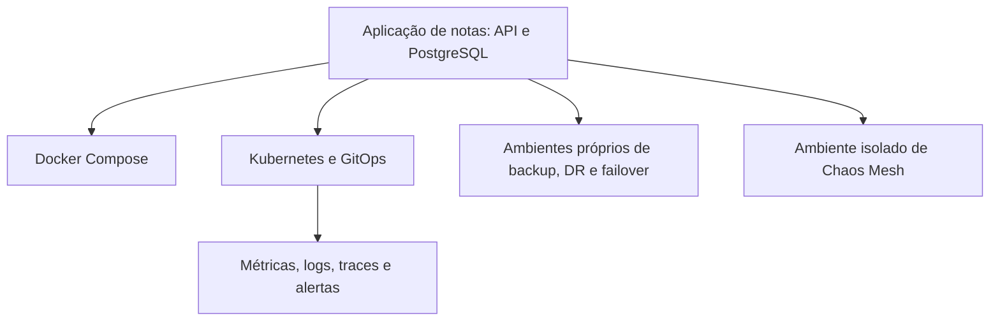

# DevOps na prática

[English](README.en.md) · Português

Este é o ponto de entrada dos meus labs de DevOps. O fio condutor é uma aplicação de notas com API e PostgreSQL: primeiro ela roda em containers; depois entram publicação de imagens, Kubernetes, GitOps, observabilidade e recuperação.

Cada repositório guarda o código, como executar o exercício e o que aconteceu nos testes. Também entram os builds quebrados, os restores com avisos e as investigações que ainda têm perguntas abertas.

**[Arquitetura geral](docs/architecture.md) · [Ordem de estudo](docs/study-guide.md) · [Resultados e evidências](docs/results.md)**

## Uma visão do conjunto

Os labs reaproveitam a aplicação em ambientes diferentes. O [mapa de arquitetura](docs/architecture.md) detalha a publicação no GHCR, o papel do Argo CD e quais componentes são compartilhados. Jenkins, Terraform e Ansible têm exercícios próprios, conectados pela trilha de estudo.

## Alguns resultados para abrir primeiro

| Pergunta | Onde olhar |
| --- | --- |
| O que acontece quando uma réplica some? | [Captura na matriz de resiliência](https://github.com/tommmdl/chaos-lab/blob/main/docs/resilience-timeouts.md): 146 verificações no CI e cinco timeouts TCP reproduzidos; um backend continua sem identificação. |
| A aplicação consegue ir para outro cluster e voltar? | [Failover e failback](https://github.com/tommmdl/failover-lab/blob/main/docs/validation.md): 48 verificações locais e no CI, com bloqueio do escritor anterior e reconciliação de uma escrita incerta. |
| O backup realmente restaura? | [Recuperação entre clusters](https://github.com/tommmdl/disaster-recovery-lab/blob/main/docs/validation.md): 32 verificações locais e no CI, com dados conferidos e dois avisos do restore mantidos. |
| A imagem publicada é a que passou pelos testes? | [Entrega pelo GitHub Actions](https://github.com/tommmdl/github-actions-lab/blob/main/docs/validation.md): execução registrada com 23 testes e conferência da identidade da imagem até o pull do GHCR. |

Os números pertencem às execuções indicadas nos links. O [guia de resultados](docs/results.md) reúne outras evidências, incluindo self-heal, tracing e migrações de imagens com rollback testado.

## Os 18 labs

| Etapa | Repositório | O que praticar |
| --- | --- | --- |
| 1 · Base | [linux-operations-lab](https://github.com/tommmdl/linux-operations-lab) | Ler memória, disco e carga antes de formular um diagnóstico. |
| 2 · Aplicação | [docker-lab](https://github.com/tommmdl/docker-lab) | Conectar API e banco, preservar dados e recuperar uma falha de dependência. |
| 3 · Entrega | [jenkins-lab](https://github.com/tommmdl/jenkins-lab) | Comparar builds de sucesso e falha e os artefatos dos dois. |
| 3 · Entrega | [github-actions-lab](https://github.com/tommmdl/github-actions-lab) | Testar uma revisão da aplicação e publicar a mesma imagem no GHCR. |
| 4 · Automação | [terraform-lab](https://github.com/tommmdl/terraform-lab) | Criar recursos Docker com módulos, observar drift e executar destroy. |
| 4 · Automação | [ansible-lab](https://github.com/tommmdl/ansible-lab) | Configurar dois alvos Docker, conferir idempotência e corrigir drift. |
| 5 · Cluster | [kubernetes-lab](https://github.com/tommmdl/kubernetes-lab) | Explorar réplicas, Services, PVCs, escala e rollback em kind. |
| 5 · Cluster | [kubernetes-config-lab](https://github.com/tommmdl/kubernetes-config-lab) | Praticar 26 exercícios de ConfigMaps, Secrets, TLS e Downward API. |
| 6 · Estado desejado | [argocd-lab](https://github.com/tommmdl/argocd-lab) | Comparar drift com self-heal desligado e ligado. |
| 6 · Imagens | [security-lab](https://github.com/tommmdl/security-lab) | Ler scans, entender bloqueios e testar alternativas sem ocultar achados. |
| 7 · Observabilidade | [monitoring-lab](https://github.com/tommmdl/monitoring-lab) | Consultar sondas HTTP no Prometheus e no Grafana. |
| 7 · Observabilidade | [logging-lab](https://github.com/tommmdl/logging-lab) | Seguir logs da API e do banco pelo Alloy, Loki e Grafana. |
| 7 · Observabilidade | [tracing-lab](https://github.com/tommmdl/tracing-lab) | Acompanhar spans HTTP/SQL e localizar logs pelo trace ID. |
| 7 · Observabilidade | [alerting-lab](https://github.com/tommmdl/alerting-lab) | Provocar falhas e conferir notificações, agrupamento e recuperação. |
| 8 · Recuperação | [backup-restore-lab](https://github.com/tommmdl/backup-restore-lab) | Restaurar recursos e dump PostgreSQL com Velero em outro namespace. |
| 8 · Recuperação | [disaster-recovery-lab](https://github.com/tommmdl/disaster-recovery-lab) | Recuperar em outro cluster com a origem do exercício parada e isolada. |
| 8 · Recuperação | [failover-lab](https://github.com/tommmdl/failover-lab) | Executar uma troca controlada com replicação síncrona e retorno dos dados. |
| 9 · Investigação | [chaos-lab](https://github.com/tommmdl/chaos-lab) | Exercitar falhas de Pods/rede e cruzar HTTP, alertas, pacotes e eventos do kernel. |

A [ordem de estudo](docs/study-guide.md) explica o que preparar, o que observar e quando avançar. Dá para começar por Linux e Docker ou abrir um resultado e voltar às peças que o sustentam.

## Como acompanhar e repetir

Cada README de lab tem seus pré-requisitos, instalação e limpeza. Várias integrações usam repositórios como pastas irmãs; o guia indica essas dependências. O portfólio não exige subir todos os ambientes ao mesmo tempo.

Os testes são de laboratório, em Docker/WSL e kind. Clusters no mesmo host compartilham um domínio de falha; os ensaios de recuperação não medem perda da máquina ou disponibilidade de produção. Scans e tempos de teste são fotografias das execuções registradas.

A implementação e as primeiras validações tiveram ajuda do assistente. Repetir os exercícios e explicar as decisões faz parte do estudo. O [diário](journal/README.md) registra a evolução; o [modelo de anotação](templates/daily-log.md) ajuda a guardar hipóteses, erros e próximos passos. O ritmo é livre, sem publicação diária automática.

Documentação em português e inglês · [Sobre a revisão do histórico](docs/history.md)
