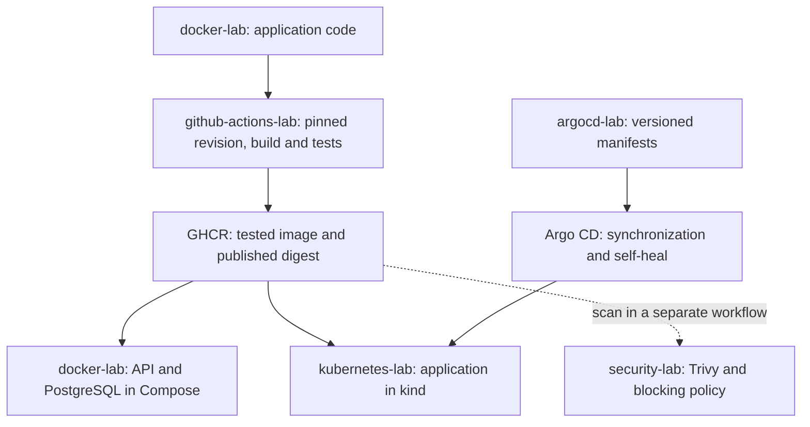
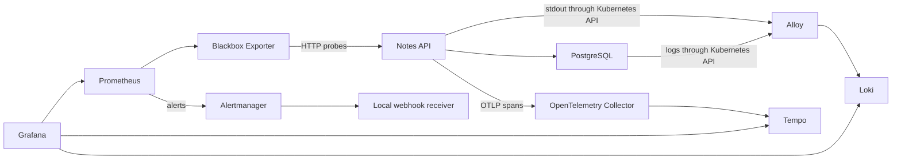
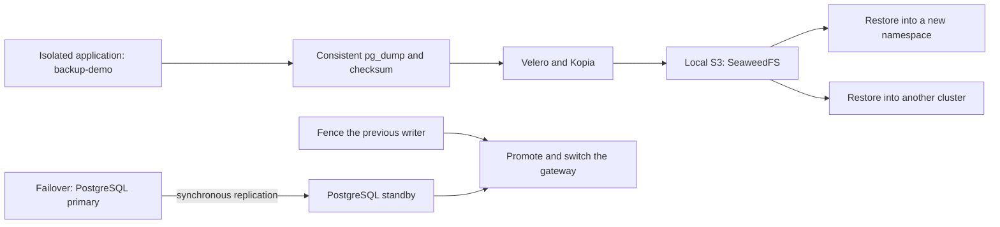

# How the labs fit together

[Português](architecture.md) · [Home](../README.en.md) · [Study order](study-guide.en.md)

The notes application connects the exercises. Its API uses Flask and Psycopg to access PostgreSQL; the instrumented variant adds OpenTelemetry. Code starts in [docker-lab](https://github.com/tommmdl/docker-lab), while other projects select specific revisions or images for their tests.

## From code to desired state

The publication workflow checks the built image, transfers its artifact to the publishing job and verifies its identity. The revision in [source.json](https://github.com/tommmdl/github-actions-lab/blob/main/source.json) can differ from the Docker lab's current `main`. Read each result alongside its source revision.

Choosing a digest for an environment and updating manifests are explicit steps. The Trivy gate runs in security-lab and is not a dependency of the publication workflow. A published image can still be blocked by the security policy.

In the integrated cluster, Argo CD becomes the reference for application configuration. The basic option lives in [workloads/notes](https://github.com/tommmdl/argocd-lab/tree/main/workloads/notes); the instrumented option lives in [workloads/notes-traced](https://github.com/tommmdl/argocd-lab/tree/main/workloads/notes-traced). The tracing-lab procedure selects that variant. Self-heal can revert manual replica changes.

Alpine API and database digests were adopted after separate backup and rollback exercises. The [API adoption report](https://github.com/tommmdl/security-lab/blob/main/docs/api-adoption.en.md) and [PostgreSQL adoption report](https://github.com/tommmdl/security-lab/blob/main/docs/postgres-adoption.en.md) distinguish that adoption from historical demonstrations and revisions.

## Observing the application

Monitoring-lab measures availability and latency through `/healthz` and `/readyz` probes. Logging-lab collects logs from authorized Pods. Tracing-lab follows API and SQL-client spans, with links to logs through the trace ID. Alerting-lab reuses Prometheus and Blackbox and adds Alertmanager and a local receiver.

SQL spans observe the Psycopg client. Notification tests check delivery to the local receiver. Each lab explains the scope of these observations and the faults used to exercise them.

## Where environments run

| Environment | Responsibility and dependencies |
| --- | --- |
| Docker lab Compose | API and database with their own network and volume; the shortest starting point for exploring the application. |
| Terraform lab | Creates its own network, containers and volume through the Docker provider. This is local infrastructure practice. |
| Ansible lab | Configures Nginx in `blue` and `green` containers through the Docker plugin; a separate server-configuration route. |
| Jenkins lab | Controller, parameterized job and volume for comparing builds and retaining history. |
| `devops-notes` / `notes-lab` | Main Kubernetes lab application, adopted by Argo CD and observed by the integrated labs. |
| Observability in `devops-notes` | Prometheus/Grafana, Loki/Alloy, Collector/Tempo and alerting have components and permissions described in their repositories. |
| Kubernetes Config lab | Configuration exercises in a separate namespace, using the local cluster. |
| Backup lab | Application copy in `backup-demo`; restores into another namespace. Velero/Kopia store the dump in local S3 provided by SeaweedFS. |
| DR lab | Restores the backup into `devops-recovery`, in namespace `dr-notes`, with the exercise's isolated source stopped. |
| Failover lab | Namespace `failover-demo` in each cluster, dedicated synchronously replicated databases and a gateway for controlled switching. |
| Chaos lab | Application in `chaos-demo`, observation in `chaos-observe` and Chaos Mesh in `chaos-system`; experiments are separated from the main application. |
| Firecracker lab | Independent Linux/WSL2 KVM microVM with a compiled kernel and minimal rootfs; no Kubernetes, networking or notes application inside the guest. |

Separate namespaces or clusters help define exercise boundaries. Local environments still share Docker/WSL and the computer.

## Recovering data and switching service

Backup/DR and failover are different exercises. Backup restores the point recorded in the dump; a later write falls outside that recovery point. Failover uses physical replication and requires confirmation that the previous writer is fenced before promotion. Returning service accounts for writes made at the destination.

Local and CI tests do not establish host-loss tolerance, offsite storage, automatic elections or production RTO/RPO. Restore warnings, writes with uncertain responses and connection failures remain part of the [evidence](results.en.md).

## A separate microVM route

[Firecracker-lab](https://github.com/tommmdl/firecracker-lab/blob/main/README.en.md) starts with pinned Linux and BusyBox versions and hashes, verifies the kernel signature and builds a fresh ext4 image. Each test boots a copy through Firecracker and checks guest responses, shutdown and unchanged original hashes. The [account](https://github.com/tommmdl/firecracker-lab/blob/main/docs/build-from-source.en.md) retains the earlier shutdown failure and two passing boots after the correction.

This route is separate from API delivery and the clusters. `jailer` validation, kernel/console hardening and networking/outbound restriction tests remain before moving to third-party workloads.

## Before running anything

Start with the selected lab's prerequisites and Kubernetes contexts. Integrations often expect sibling checkouts. Once Argo CD adopts the application, use the GitOps flow to change its state. Run environment-changing tests one at a time and follow that repository's cleanup procedure; some commands retain volumes while others remove data.
