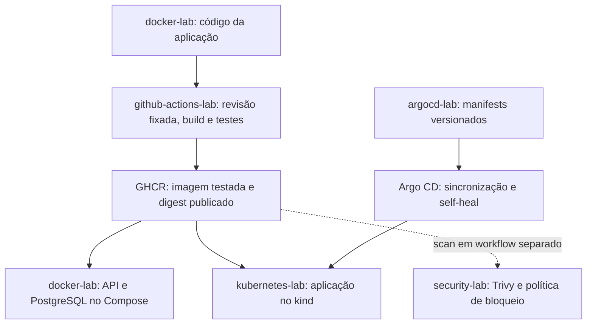
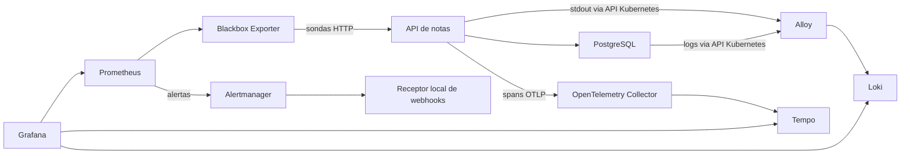
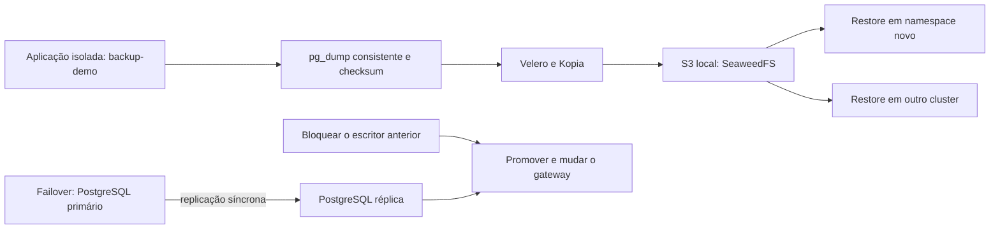

# Como os labs se conectam

[English](architecture.en.md) · [Início](../README.md) · [Ordem de estudo](study-guide.md)

A aplicação de notas dá continuidade aos exercícios. A API usa Flask e Psycopg para acessar PostgreSQL; a variante instrumentada acrescenta OpenTelemetry. O código começa no [docker-lab](https://github.com/tommmdl/docker-lab), e os demais projetos escolhem revisões ou imagens específicas para seus testes.

## Do código ao estado desejado

O workflow de publicação verifica a imagem construída, transfere o artefato para o job de publicação e confere sua identidade. A revisão em [source.json](https://github.com/tommmdl/github-actions-lab/blob/main/source.json) pode ser diferente da `main` atual do Docker lab. Cada resultado deve ser lido com sua revisão de origem.

A escolha de um digest para o ambiente e a atualização dos manifests são explícitas. O gate do Trivy roda no security-lab e não é uma dependência do workflow de publicação. Uma imagem publicada pode continuar bloqueada pela política de segurança.

No cluster integrado, o Argo CD passa a ser a referência para a configuração da aplicação. A opção básica está em [workloads/notes](https://github.com/tommmdl/argocd-lab/tree/main/workloads/notes); a instrumentada, em [workloads/notes-traced](https://github.com/tommmdl/argocd-lab/tree/main/workloads/notes-traced). A seleção da variante é feita pelo procedimento do tracing-lab. Mudanças manuais em réplicas podem ser revertidas pelo self-heal.

Os digests Alpine da API e do banco foram adotados depois de ensaios próprios de backup e rollback. O [relato da API](https://github.com/tommmdl/security-lab/blob/main/docs/api-adoption.md) e o [do PostgreSQL](https://github.com/tommmdl/security-lab/blob/main/docs/postgres-adoption.md) distinguem essa adoção das demonstrações e revisões históricas.

## Observar a aplicação

O monitoring-lab mede disponibilidade e latência por sondas de `/healthz` e `/readyz`. O logging-lab coleta logs dos Pods autorizados. O tracing-lab acompanha spans da API e do cliente SQL, com ligação para os logs pelo trace ID. O alerting-lab reaproveita o Prometheus e o Blackbox e acrescenta Alertmanager e um receptor local.

Os spans SQL observam o cliente Psycopg. Os testes de notificação conferem entrega ao receptor local. Cada lab explica o alcance dessas observações e as falhas usadas para exercitá-las.

## Onde cada ambiente fica

| Ambiente | Responsabilidade e dependências |
| --- | --- |
| Compose do Docker lab | API e banco com rede e volume próprios; é o começo mais curto para explorar a aplicação. |
| Terraform lab | Cria sua própria rede, containers e volume pelo provider Docker. É um exercício de infraestrutura local. |
| Ansible lab | Configura Nginx em dois containers `blue` e `green`, pelo plugin Docker; é uma trilha de configuração de servidores. |
| Jenkins lab | Controller, job parametrizado e volume para comparar builds e preservar o histórico. |
| `devops-notes` / `notes-lab` | Aplicação principal do Kubernetes lab, adotada pelo Argo CD e observada pelos labs integrados. |
| Observabilidade no `devops-notes` | Prometheus/Grafana, Loki/Alloy, Collector/Tempo e alertas têm componentes e permissões descritos nos respectivos repos. |
| Kubernetes Config lab | Exercícios de configuração em namespace separado, usando o cluster local. |
| Backup lab | Cópia da aplicação em `backup-demo`; restaura em outro namespace. Velero/Kopia guardam o dump em S3 local fornecido pelo SeaweedFS. |
| DR lab | Restaura o backup em `devops-recovery`, no namespace `dr-notes`, com a origem isolada do exercício parada. |
| Failover lab | Namespace `failover-demo` em cada cluster, bancos próprios com replicação síncrona e gateway para a troca controlada. |
| Chaos lab | Aplicação em `chaos-demo`, observação em `chaos-observe` e Chaos Mesh em `chaos-system`; os experimentos ficam separados da aplicação principal. |

Ter namespaces ou clusters diferentes ajuda a delimitar os exercícios. Os ambientes locais continuam compartilhando Docker/WSL e o computador.

## Recuperar dados e trocar o serviço

Backup/DR e failover são exercícios distintos. O backup recupera o ponto registrado no dump; a escrita posterior ao backup fica fora desse ponto. O failover usa replicação física e exige confirmar o bloqueio do escritor anterior antes da promoção. A volta leva em conta as escritas feitas no destino.

Os testes locais e de CI não estabelecem tolerância à perda do host, armazenamento offsite, eleição automática ou RTO/RPO de produção. Os avisos de restore, escritas com resposta incerta e falhas de conexão fazem parte das [evidências](results.md).

## Antes de executar

Comece pelos pré-requisitos do lab escolhido e pelos contextos de Kubernetes indicados nele. As integrações frequentemente esperam checkouts lado a lado. Depois que o Argo CD adota a aplicação, siga o fluxo GitOps para alterar seu estado. Execute testes que alteram o ambiente um de cada vez e consulte a limpeza do próprio repositório; alguns comandos preservam volumes, outros removem dados.
